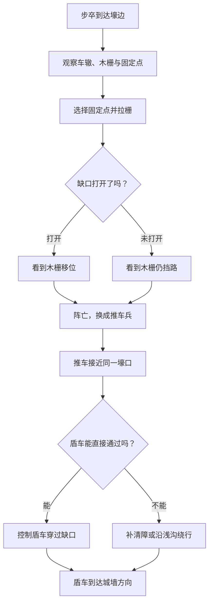
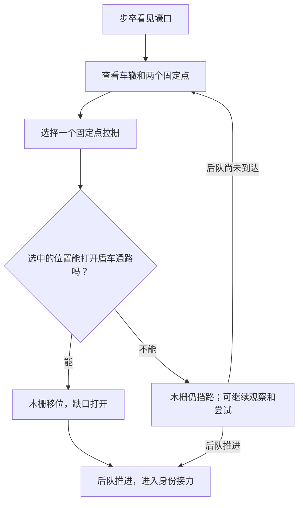
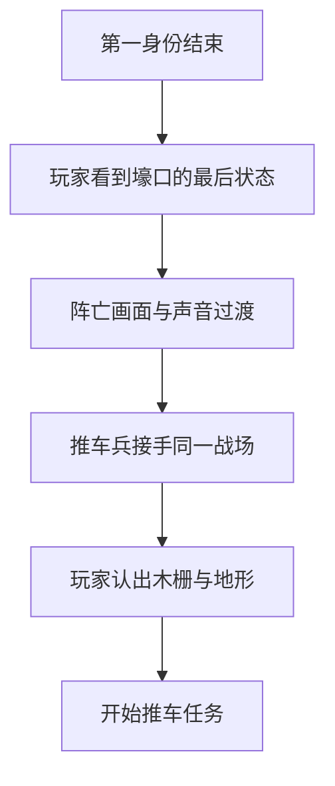
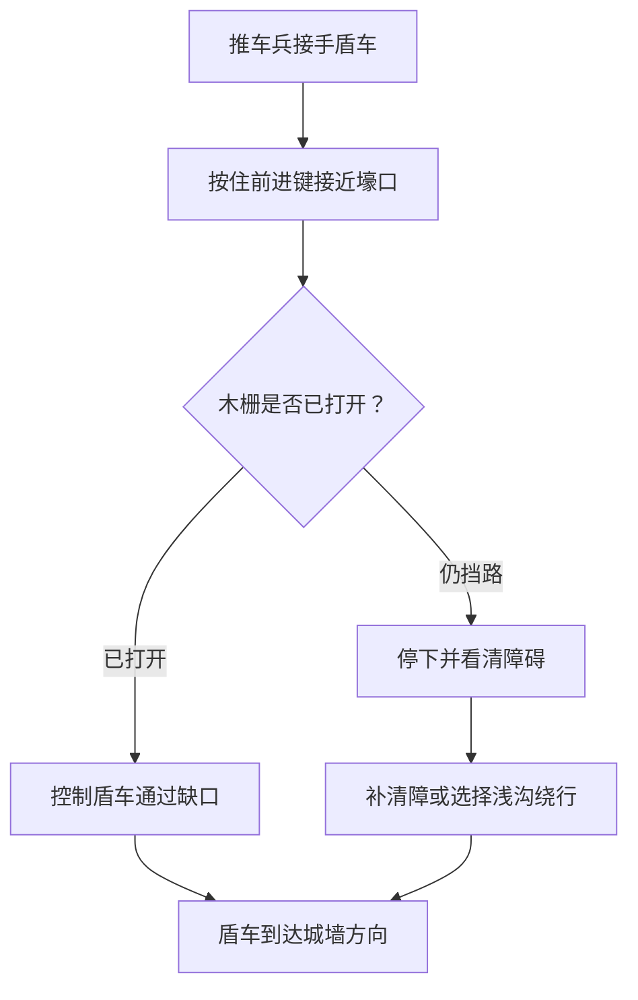

# 《壕口》游戏策划案

> **文档定位：** 统一团队对十天 Demo 的玩家体验、循环和玩法规则的理解，以玩家能观察和操作的结果进行评审。技术、人员和排期见[《十天制作计划》](壕口-十天制作计划.md)。

## 1. 评审卡片

| 文档项 | 内容 | 文档项 | 内容 |
|---|---|---|---|
| 游戏 | 《壕口》3D Demo | GDD 版本 | v1.0 |
| 文档状态 | 草稿 | 品类 | 第一人称沉浸式战场冒险 |
| 平台与方向 | 桌面端，横屏，键盘与鼠标 | 市场与语言 | 中文演示 |
| 版本范围 | 一处壕口、两名可操纵士兵、一次死亡接力 | 目标设备 | 能运行 3D Godot 项目的桌面电脑 |
| 更新日期 | 2026-11-20 | 单次体验 | 约 3–5 分钟 |

> **体验承诺：** 玩家作为一名普通士兵，凭眼前有限的线索亲手为后队打开道路；阵亡后换成推车兵，在同一处战场亲身遇到自己留下的结果。

### 本案包含

- 玩家从 3D 第一人称机位观察壕口、车辙和木栅，判断该拉开哪个固定点。
- 玩家操作木栅，其结果保留到第二名士兵的行动中。
- 阵亡后直接换人；第二名士兵推车经过壕口，并依据现场状态采取不同动作。
- 无论第一名士兵是否打开缺口，第二名士兵都能继续推进。

### 明确不包含

- 玩家在整张战场自由行走、完整近战、敌人 AI 或大规模人群战斗。
- 营地生活、第三名可操纵士兵和最终“先登”关卡。
- 真实战役复现、确定朝代或改变整场战役的结局。

### 已确认设计边界

| 设计边界 | 当前结论 |
|---|---|
| 3D 空间与移动 | 场景中的壕沟、木栅与盾车是真实 3D 物件。玩家在有限机位观察；推车时沿预设路线前进。 |
| 行动后果 | 第一身份能改变木栅是否打开。第二身份必须通过操作遇到这一差异，不能只在旁白中得知。 |
| 阵亡与失败 | 第一身份阵亡后直接换人；未开路也继续。第二身份有补清障或绕行的可行路径。 |
| 历史呈现 | Demo 是虚构攻城战，不标为某场真实战役；具体朝代未确定前，不以混合器物冒充史实。 |

### 体验支柱

| 优先级 | 体验支柱 | 对玩家的承诺 | 设计取舍 |
|---:|---|---|---|
| 1 | 亲手留下后果 | 一条命的操作改变下一条命面对的障碍 | 先保证可玩因果，再增加演出和装饰 |
| 2 | 有限视野中的判断 | 玩家根据车辙、木栅和队伍动向推断行动，而非照着答案点击 | 保留可信线索；减少悬浮导航和长篇说明 |
| 3 | 同一地点的两种处境 | 步卒眼前的小缺口，成为推车兵必须经过的入口 | 保留两种机位与同一地标；不扩成大地图 |

### 核心概念

| 概念 / 术语 | 在本游戏中的含义 | 玩家可见名称 | 容易混淆的概念 |
|---|---|---|---|
| 接力 | 第一身份阵亡后，玩家控制第二身份；场景状态延续 | 无系统名称，以视角变化呈现 | 不是读档重试，前一行动不会撤销 |
| 缺口 | 木栅被拉开后，盾车可用的通路 | 壕口 | 不是仅供步卒穿过的缝隙；以盾车能否通过判断 |

---

## 2. 核心体验与循环

> **一句话定义：** 这是一段约 3–5 分钟的桌面端 3D 战场冒险。玩家先观察并处理壕口障碍，再换一个身体亲手使用或补救前一条命留下的道路。

### 2.1 循环总览

| Loop ID | 尺度与时间 | 玩家此刻想完成什么 | 核心动作与选择 | 结果与后续动力 |
|---|---|---|---|---|
| `L-MOMENT-OBSERVE-ACT` | 单次观察或操作 | 判断眼前哪个物件、哪条路值得尝试 | 转头观察、检查、对准并操作 3D 物件 | 看到障碍移动或听见其未松动的反馈，决定下一步 |
| `L-CORE-TWO-LIVES` | 一轮约 3–5 分钟 | 让后队盾车到达城墙方向 | 第一身份开路，阵亡换人，第二身份推车与处理路线 | 亲自发现前一身份的行动怎样改变第二身份 |

### 2.2 核心体验流

---

## 3. 玩法系统与需求验收

### 3.1 `SYS-DITCH-CLEAR` 壕口观察与开路

#### 系统概述

| 项目 | 已确认内容 |
|---|---|
| 设计目的 | 让玩家凭战场线索作出一个有空间意义的判断，并亲手改变木栅。 |
| 玩家体验 | 步卒从固定站位观察车辙和两个固定点，选定一处拉栅；木栅移位或保持原状，玩家能看懂自己的行动是否为盾车开了路。 |
| 系统边界 | 只负责第一身份的观察与开路；死亡换人由 `SYS-RELAY-HANDOFF` 负责，盾车通行由 `SYS-CART-PASS` 负责。 |
| 所属 Loop | `L-MOMENT-OBSERVE-ACT`、`L-CORE-TWO-LIVES` |
| 入口与结束 | 玩家进入壕边步卒视角后开始；后队推进时结束，带着木栅状态进入接力。 |

#### 系统流程

#### 对象

| 对象 ID | 对象名称 | 状态与含义 | 玩家如何识别 |
|---|---|---|---|
| `O-DITCH-BARRICADE` | 木栅 | 挡路：盾车不能直行；打开：盾车可走壕口 | 玩家能看到木栅的位置、缺口宽度及车辙方向 |
| `O-DITCH-ANCHORS` | 两个固定点 | 一个能将木栅拉向车辙外侧；另一个不能打开足够宽的路 | 固定点在木栅的不同侧，玩家可对照车辙与盾车宽度判断 |

#### 机制

| 机制 ID | 机制名称 | 设计规则 | 玩家反馈 |
|---|---|---|---|
| `M-DITCH-INSPECT-01` | 观察与检查 | **重要性：核心。触发：**玩家看向可检查的地形或固定点并按 `E`。**规则：**揭示其与车辙、木栅的空间关系；不自动选出正确位置。**结果与边界：**不检查也可操作，但必须能直接从场景读到基本线索。 | 视角与简短提示让玩家知道正在检查什么，以及拉动后木栅可能向哪侧移动。 |
| `M-DITCH-PULL-02` | 拉开木栅 | **重要性：核心。触发：**玩家对准固定点并按住 `E`。**规则：**拉对位置且完成动作，木栅打开；拉错时仍挡路，后队推进前可改选。**结果与边界：**未完成操作时状态保持挡路，不阻断换人。 | 木栅的 3D 位置与声音立即变化；拉错时能看见它卡住，玩家仍可尝试另一侧。 |

#### 页面

| 页面 ID | 页面名称 | 页面元素及优先级 | 页面交互及状态 |
|---|---|---|---|
| `S-DITCH-FIRST` | 步卒壕边场景 | **P0：**打开可供盾车通过的路。 **P1：**车辙、木栅、两个固定点和后队动向。 **P2：**木栅是否移位。 **P3：**当前可用操作与暂停提示。 **P4：**远处战场声与光影。 | **主要交互：**转头、按 `E` 检查 `O-DITCH-ANCHORS`、按住 `E` 拉动 `O-DITCH-BARRICADE`；`Esc` 暂停。 **状态变化：**拉开后看见缺口；未拉开时仍能看见障碍。 **离开方式：**后队推进后进入 `SYS-RELAY-HANDOFF`，保留木栅状态。 |

### 3.2 `SYS-RELAY-HANDOFF` 阵亡与身份接力

#### 系统概述

| 项目 | 已确认内容 |
|---|---|
| 设计目的 | 让阵亡成为继续体验前一行动后果的入口。 |
| 玩家体验 | 步卒倒下后，玩家听见木轮声并从推车兵的视角重新看见同一处壕口；木栅没有复原。 |
| 系统边界 | 只负责身份与视角交接、现场状态延续；不判定第二身份的通行路线。 |
| 所属 Loop | `L-CORE-TWO-LIVES` |
| 入口与结束 | 后队推进、第一身份结束时进入；第二身份能操纵盾车时结束。 |

#### 系统流程

#### 机制

| 机制 ID | 机制名称 | 设计规则 | 玩家反馈 |
|---|---|---|---|
| `M-RELAY-HANDOFF-01` | 死亡后换人 | **重要性：核心。触发：**第一身份结束。**规则：**不弹重试，直接进入推车兵视角；`O-DITCH-BARRICADE` 保持交接前状态。**结果与边界：**无论开路成功与否，第二身份均可继续。 | 同一地标和木栅的位置帮助玩家认出旧场地；木轮声与新视角提示身份已变。 |

### 3.3 `SYS-CART-PASS` 推车与壕口通行

#### 系统概述

| 项目 | 已确认内容 |
|---|---|
| 设计目的 | 让玩家通过第二身份的身体动作验证上一身份的行动价值。 |
| 玩家体验 | 推车兵从后队出发，控制盾车接近熟悉的木栅；路已打开就直接通过，路没开就停下补清障或绕行。 |
| 系统边界 | 只处理盾车从起点到城墙方向的路线；木栅状态由上游系统给出，不在此重置。 |
| 所属 Loop | `L-MOMENT-OBSERVE-ACT`、`L-CORE-TWO-LIVES` |
| 入口与结束 | 玩家取得推车控制权后进入；盾车到达城墙方向时结束 Demo。 |

#### 系统流程

#### 对象

| 对象 ID | 对象名称 | 状态与含义 | 玩家如何识别 |
|---|---|---|---|
| `O-CART-SHIELD` | 盾车 | 停下：等待玩家处理前路；推进：沿预设路线移动；到达：本段目标完成 | 玩家始终从车后位置看到车梁与木轮，能感到车是否前进 |

#### 机制

| 机制 ID | 机制名称 | 设计规则 | 玩家反馈 |
|---|---|---|---|
| `M-CART-PUSH-01` | 推车前进 | **重要性：核心。触发：**玩家按住 `W`。**规则：**盾车沿预设路线前进；松开则停下。**结果与边界：**到达岔口或障碍时，玩家仍能观察并选择下一步。 | 木轮运动、车梁位置与路面变化共同表明推进，不用结算文字替代动作。 |
| `M-CART-ROUTE-02` | 遇阻改道 | **重要性：核心。触发：**盾车到达壕口。**规则：**木栅打开可直行；木栅挡路时，玩家可停下按住 `E` 补清障使缺口打开，或用 `A/D` 在岔口选浅沟路。**结果与边界：**两条处理路径均可到达城墙方向；绕行不改变木栅状态。 | 路口的木栅与浅沟同时可见；完成处理后盾车能继续前进。 |

#### 页面

| 页面 ID | 页面名称 | 页面元素及优先级 | 页面交互及状态 |
|---|---|---|---|
| `S-CART-SECOND` | 推车兵壕口场景 | **P0：**把盾车送到城墙方向。 **P1：**木栅、可通行缺口与浅沟岔口。 **P2：**盾车是否移动、前路是否阻断。 **P3：**推车、清障、选路与暂停提示。 **P4：**轮声与远处战场。 | **主要交互：**按住 `W` 推进 `O-CART-SHIELD`，按 `A/D` 选路、按住 `E` 清障；`Esc` 暂停。 **状态变化：**道路通畅时车继续前进；受阻时车停下，玩家可清障或改道。 **离开方式：**盾车到达城墙方向后结束 Demo。 |

---

## 附录 A. 设计参数与配置

### A.1 `SYS-DITCH-CLEAR` 壕口状态

> **设计目的：** 明确第一身份留下的最小现场状态，以及第二身份因此遇到的不同操作。

#### 正式公式与配置

| 项目 | 适用对象 / 机制 | 正式公式 / 配置 | 参数、单位与合法值 | 默认、边界与冲突处理 |
|---|---|---|---|---|
| `gap_open` | `O-DITCH-BARRICADE`、`M-DITCH-PULL-02`、`M-CART-ROUTE-02` | 第一身份拉对固定点并完成操作，或第二身份完成补清障后为 `true`；其余保持原值 | 布尔值：`true` / `false` | 初始 `false`；阵亡后保持当前值；重复拉动不再改变已打开状态 |

#### 参数 / 配置 Case

| Case | 参数 / 配置完整值 | 正式计算或配置结果 | 玩家结果 |
|---|---|---|---|
| 拉对并完成 | `gap_open` 初始 `false`；选对固定点；操作完成 | `gap_open = true` | 木栅移位；推车兵可从缺口直行 |
| 仅拉错且未改选，或未完成 | `gap_open` 初始 `false`；未完成正确固定点的拉动 | `gap_open = false` | 木栅仍挡路；推车兵补清障或绕行 |
| 推车兵补清障 | 换人时 `gap_open = false`；第二身份完成补清障 | `gap_open = true` | 木栅在第二身份中打开，盾车随后直行 |

